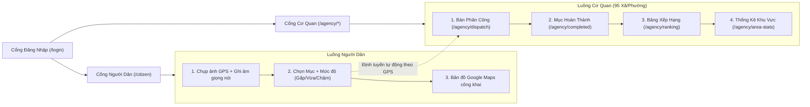

# Pitch Deck (10 Slides) & Bộ Mockup 7 Màn Hình — Tai Mắt Công Dân Đồng Nai

> [!IMPORTANT]
> Tài liệu bao gồm **Pitch Deck 10 Slide** (dùng để thuyết trình hội đồng/ban giám khảo) và **Bộ Mockup 7 Màn Hình** (3 màn luồng Người dân gửi + 3 màn luồng Cán bộ xử lý + 1 màn Dashboard công khai) bám sát 100% kiến trúc thực tế của hệ thống.

---

## PHẦN 1: PITCH DECK 10 SLIDE

````carousel
### SLIDE 1: TRANG BÌA (TITLE SLIDE)
# TAI MẮT CÔNG DÂN ĐỒNG NAI
**Hệ thống Phản ánh Hạ tầng Đô thị Trực tuyến & Điều phối Xử lý Liên thông 95 Xã/Phường**

- **Định vị giải pháp:** Nền tảng GovTech kết nối trực tiếp Người dân và Cơ quan quản lý đô thị tỉnh Đồng Nai.
- **Điểm nhấn công nghệ:**
  - Chụp ảnh hiện trường đóng dấu **Tọa độ GPS & Thời gian thực** tự động (Anti-fake Watermark).
  - Nhập liệu rảnh tay bằng **Ghi âm chuyển thành văn bản tiếng Việt (Speech-to-Text)**.
  - Tách biệt hoàn toàn **Cổng Người Dân** và **Cổng Cơ Quan** kèm **Dashboard xếp hạng KPI 95 Xã/Phường**.

<!-- slide -->
### SLIDE 2: VẤN ĐỀ THỰC TIỄN (THE PROBLEM)
# Bất Cập Trong Tiếp Nhận & Xử Lý Sự Cố Hạ Tầng Hiện Nay

1. **Thông tin thiếu xác thực & sai lệch vị trí:**
   - Phản ánh qua mạng xã hội hoặc hotline truyền thống thiếu tọa độ chính xác, ảnh cũ không rõ thời điểm chụp.
2. **Biểu mẫu hành chính rườm rà:**
   - Người dân ngại gửi báo cáo vì phải điền quá nhiều trường thông tin không cần thiết khi đang ở ngoài đường.
3. **Thiếu phân loại mức độ ưu tiên:**
   - Sự cố nguy hiểm khẩn cấp (dây điện võng, sập hố ga) bị trộn lẫn với sự cố bảo trì định kỳ.
4. **Khó giám sát trách nhiệm địa phương:**
   - Chưa có bảng xếp hạng minh bạch để đo lường tốc độ xử lý (SLA) giữa các Xã/Phường.

<!-- slide -->
### SLIDE 3: GIẢI PHÁP ĐỘT PHÁ (THE SOLUTION)
# "Chạm Nhanh Hiện Trường — Định Tuyến Đúng Phường — Minh Bạch Từng Giờ"

- **Gửi phản ánh trong 15 giây:**
  - Tự động ghim tọa độ **Google Maps** và nhận diện đúng 1 trong **95 Xã/Phường** qua thuật toán khoảng cách Haversine.
  - Chỉ giữ các trường cốt lõi: **Mục báo cáo (gồm Mục khác) + Mức độ (Gấp / Vừa / Chậm) + Địa chỉ + Mô tả bằng giọng nói**.
- **Điều phối có cam kết SLA:**
  - Mỗi hạng mục gắn hạn mức SLA rõ ràng (6h – 24h) và phân luồng theo mức độ khẩn cấp.
- **Công khai kết quả 100%:**
  - Mọi hồ sơ từ lúc tiếp nhận, phân công cán bộ đến khi nghiệm thu đều hiển thị thời gian thực.

<!-- slide -->
### SLIDE 4: KIẾN TRÚC PHÂN LUỒNG ĐỘC LẬP (SYSTEM ARCHITECTURE)
# Tách Biệt Hoàn Toàn Giao Diện Người Dân & Cơ Quan



<!-- slide -->
### SLIDE 5: CÔNG NGHỆ XÁC THỰC HIỆN TRƯỜNG (CORE TECH)
# 3 Trụ Cột Công Nghệ Trực Quan

| Công nghệ | Cơ chế hoạt động trong hệ thống | Giá trị thực tế |
| :--- | :--- | :--- |
| **1. Canvas Anti-Fake Watermark** | Đốt trực tiếp lớp thông tin `GPS (Lat, Lng, ±m)` + `Giờ thực (dd/mm/yyyy hh:mm:ss)` + `Xã/Phường` lên ảnh hiện trường qua HTML5 Canvas. | Chống làm giả ảnh, làm bằng chứng nghiệm thu pháp lý. |
| **2. Vietnamese Speech-to-Text** | Sử dụng Web Speech API (`lang = 'vi-VN'`) chuyển giọng nói trực tiếp thành văn bản mô tả sự cố. | Giúp người dân báo cáo nhanh tại hiện trường không cần gõ phím. |
| **3. Google Maps + Haversine Routing** | Tích hợp bản đồ Google Maps (Đường phố & Vệ tinh) kết hợp hàm `findNearestWard(lat, lng)`. | Tự động định tuyến phản ánh về đúng UBND trong 95 Xã/Phường. |

<!-- slide -->
### SLIDE 6: PHÂN LOẠI HẠNG MỤC & MỨC ĐỘ KHẨN CẤP (TRIAGE MATRIX)
# Ma Trận Phân Loại & Cam Kết Thời Gian Xử Lý (SLA)

### 6 Hạng mục báo cáo chuẩn hóa:
- **Cây ngã đổ / Dây điện võng:** SLA tối đa **6 giờ**
- **Rác thải tồn đọng / Ô nhiễm:** SLA tối đa **8 giờ**
- **Đèn đường hỏng / Chiếu sáng:** SLA tối đa **12 giờ**
- **Ngập nước / Cống thoát nước:** SLA tối đa **12 giờ**
- **Ổ gà / Mặt đường hư hỏng:** SLA tối đa **24 giờ**
- **Mục khác:** Cho phép người dân tự nhập tên sự cố phát sinh thực tế (SLA **24 giờ**)

### 3 Mức độ ưu tiên từ người dân:
- **GẤP (`urgent`):** Nguy hiểm trực tiếp, ưu tiên điều phối ngay trong ngày.
- **VỪA (`medium`):** Ảnh hưởng sinh hoạt/giao thông khu vực, xử lý theo khung giờ chuẩn.
- **CHẬM (`slow`):** Sự cố nhẹ, lên lịch xử lý định kỳ theo kế hoạch bảo trì.

<!-- slide -->
### SLIDE 7: QUY MÔ LIÊN THÔNG TOÀN TỈNH (SCALE & COVERAGE)
# Bao Phủ 7 Cụm Khu Vực — 95 Xã/Phường Tỉnh Đồng Nai

| Cụm Khu Vực | Số Đơn Vị | Địa bàn trọng điểm tiêu biểu |
| :--- | :---: | :--- |
| **1. Khu vực Biên Hòa** | 25 | Trấn Biên, Biên Hòa, Tam Hiệp, Long Bình, Trảng Dài, Hố Nai... |
| **2. Khu vực Long Khánh** | 14 | Xuân An, Xuân Bình, Xuân Hòa, Phú Bình, Suối Tre, Hàng Gòn... |
| **3. Khu vực Long Thành** | 13 | Long Thành, An Phước, Bình Sơn, Lộc An, Long Đức, Phước Thái... |
| **4. Khu vực Nhơn Trạch** | 12 | Hiệp Phước, Đại Phước, Phú Hội, Phước An, Phước Thiền... |
| **5. Khu vực Trảng Bom** | 12 | Trảng Bom, Bắc Sơn, Bình Minh, Giang Điền, Hố Nai 3, Sông Trầu... |
| **6. Vĩnh Cửu & Thống Nhất** | 12 | Vĩnh An, Thạnh Phú, Trị An, Dầu Giây, Gia Tân 1-2-3, Quang Trung... |
| **7. Xuân Lộc, Cẩm Mỹ, Định Quán, Tân Phú** | 14 | Gia Ray, Long Giao, Định Quán, La Ngà, Tân Phú, Phú Lâm... |

<!-- slide -->
### SLIDE 8: CƠ CHẾ ĐÁNH GIÁ KPI & XẾP HẠNG (ACCOUNTABILITY)
# Công Thức Chấm Điểm KPI & Bảng Xếp Hạng Công Khai

Hệ thống tự động xếp hạng 95 Xã/Phường theo thời gian thực dựa trên công thức:

$$\text{KPI Score} = 0.65 \times \text{Completion Rate (\%)} + 0.35 \times \max(0, 100 - 4.2 \times \text{Avg Hours})$$

- **Phân hạng tự động:**
  - **Dẫn Đầu (`Xuất sắc`):** $\text{KPI Score} \ge 88$ và Thời gian xử lý trung bình $\le 6.5\text{ giờ}$.
  - **Chuẩn (`Tốt`):** Đạt tiến độ cam kết SLA.
  - **Đôn Đốc (`Cần đôn đốc`):** $\text{KPI Score} < 76$ hoặc Thời gian xử lý $> 10.5\text{ giờ}$ hoặc tồn đọng $\ge 2$ hồ sơ mới chưa phân công.

<!-- slide -->
### SLIDE 9: HIỆU QUẢ ĐẠT ĐƯỢC & LỘ TRÌNH (IMPACT & ROADMAP)
# Tác Động Thực Tế & Lộ Trình Mở Rộng

### Hiệu quả vận hành:
- **Rút ngắn 68% thời gian tiếp nhận & điều phối** so với quy trình giấy tờ/hotline truyền thống.
- **Thời gian xử lý trung bình ~4.5 – 6.4 giờ/vụ**, giảm tối đa điểm nóng hạ tầng kéo dài.
- **100% hồ sơ có ảnh đóng dấu tọa độ & nhật ký (Audit Trail)** minh bạch.

### Lộ trình phát triển:
- **Giai đoạn 1 (Hiện tại):** Web App PWA chạy trực tiếp trên trình duyệt di động & máy tính cho 95 Xã/Phường.
- **Giai đoạn 2 (Q1/2027):** Tích hợp AI Computer Vision tự động nhận diện ổ gà/rác thải từ ảnh chụp và kết nối Zalo Mini App.
- **Giai đoạn 3 (Q3/2027):** Đồng bộ IOC Tỉnh Đồng Nai & cảnh báo tự động qua SMS/Zalo cho cán bộ phụ trách khi sắp quá hạn SLA.

<!-- slide -->
### SLIDE 10: TỔNG KẾT & DEMO TRỰC TIẾP (CALL TO ACTION)
# Sẵn Sàng Vận Hành Thực Tế

- **Thiết kế giao diện chuẩn hiện đại:**
  - Nền trắng sáng, khung xanh biển nhạt (`border-sky-300`), khi chọn chuyển khung xám (`bg-slate-200 border-slate-500`) rõ ràng, dễ thao tác ngoài trời.
- **Trải nghiệm Demo sống 100% (Click-to-Run):**
  1. Đăng nhập 1 chạm với tài khoản **Người dân** hoặc **Cán bộ UBND Phường/Xã**.
  2. Chụp ảnh có đóng dấu GPS + Dùng giọng nói tiếng Việt mô tả sự cố + Chọn mức độ **Gấp/Vừa/Chậm**.
  3. Chuyển sang cổng **Cơ quan**: Mở Popup phân công cán bộ → Nghiệm thu → Xem cập nhật tức thì trên **Bảng xếp hạng 95 Xã/Phường**.
````

---

## PHẦN 2: BỘ MOCKUP 7 MÀN HÌNH CHI TIẾT

### A. LUỒNG NGƯỜI DÂN GỬI PHẢN ÁNH (3 MÀN HÌNH)

````carousel
### MÀN 1/3 (NGƯỜI DÂN): ĐĂNG NHẬP & CHỤP ẢNH HIỆN TRƯỜNG KÈM GPS
**File thực thi:** [LoginView.jsx](file:///d:/New%20folder%20(2)/src/components/LoginView.jsx) & Cột trái [ReportForm.jsx](file:///d:/New%20folder%20(2)/src/components/ReportForm.jsx)

```
+-----------------------------------------------------------------------------------+
| [ĐN] TAI MẮT CÔNG DÂN ĐỒNG NAI (Cổng Người Dân)     [Gửi Phản Ánh] [Bản Đồ] [ĐN] |
+-----------------------------------------------------------------------------------+
|  1. GHI NHẬN HIỆN TRƯỜNG (CAMERA + GPS)                     🕒 15/11/2026 16:45:00|
|  +-----------------------------------------------------------------------------+  |
|  | [🎥 Mở Camera]  [📤 Tải ảnh]  [✨ Chụp thử nghiệm]                          |  |
|  |                                                                             |  |
|  |   +---------------------------------------------------------------------+   |  |
|  |   |                     [ ẢNH CHỤP HIỆN TRƯỜNG ]                        |   |  |
|  |   |                                                   [✓ ĐÃ ĐÓNG DẤU]   |   |  |
|  |   |  +---------------------------------------------------------------+  |   |  |
|  |   |  | HỆ THỐNG XÁC THỰC HIỆN TRƯỜNG — ĐỒNG NAI SMART CITY           |  |   |  |
|  |   |  | GPS: 10.949821, 106.854112 (Sai số: ±4m)                      |  |   |  |
|  |   |  | THỜI GIAN: 15/11/2026 16:45:00                                |  |   |  |
|  |   |  | ĐỊA BÀN: Phường Tam Hiệp | HẠNG MỤC: Ổ gà / Mặt đường hư hỏng |  |   |  |
|  |   |  +---------------------------------------------------------------+  |   |  |
|  |   +---------------------------------------------------------------------+   |  |
|  +-----------------------------------------------------------------------------+  |
|                                                                                   |
|  2. TỌA ĐỘ GPS & XÁC NHẬN ĐIỂM                             [🎯 Lấy GPS thiết bị]  |
|  +-----------------------------------------------------------------------------+  |
|  | [Lat: 10.949821]     [Lng: 106.854112]     [Khu vực: Phường Tam Hiệp]       |  |
|  | 📡 Đã thu nhận tọa độ GPS thực tế → Tự động liên kết: Phường Tam Hiệp       |  |
|  | +-------------------------------------------------------------------------+ |  |
|  | |  [BẢN ĐỒ GOOGLE MAPS TIẾNG VIỆT]          [Google Đường phố | Vệ tinh]  | |  |
|  | |                         📍 (Ghim kéo thả được)                          | |  |
|  | +-------------------------------------------------------------------------+ |  |
|  +-----------------------------------------------------------------------------+  |
+-----------------------------------------------------------------------------------+
```
- **Điểm nhấn UX:** Khung viền xanh biển nhạt (`border-sky-300`), tự động lấy tọa độ GPS khớp về xã/phường gần nhất và đốt watermark trực tiếp vào ảnh.

<!-- slide -->
### MÀN 2/3 (NGƯỜI DÂN): CHỌN MỤC (CÓ MỤC KHÁC), MỨC ĐỘ & GHI ÂM GIỌNG NÓI
**File thực thi:** Cột phải [ReportForm.jsx](file:///d:/New%20folder%20(2)/src/components/ReportForm.jsx#L615-L788)

```
+-----------------------------------------------------------------------------------+
|  3. THÔNG TIN PHẢN ÁNH HẠ TẦNG                                                    |
|  Chọn hạng mục, chỉ rõ địa chỉ và mức độ khẩn cấp để chuyển ngay tới cơ quan.     |
+-----------------------------------------------------------------------------------+
|  HẠNG MỤC PHẢN ÁNH * (Khung xanh -> Khi chọn chuyển Khung xám)                    |
|  +-------------------------------------+  +-------------------------------------+ |
|  | [ĐANG CHỌN - KHUNG XÁM]             |  | [KHUNG XANH]                        | |
|  | Ổ gà / Mặt đường hư hỏng   SLA 24h  |  | Đèn đường hỏng / Chiếu sáng SLA 12h | |
|  +-------------------------------------+  +-------------------------------------+ |
|  | Rác thải tồn đọng / Ô nhiễm SLA 8h  |  | Ngập nước / Cống thoát nước SLA 12h | |
|  +-------------------------------------+  +-------------------------------------+ |
|  | Cây ngã đổ / Dây điện võng  SLA 6h  |  | Mục khác                    SLA 24h | |
|  +-------------------------------------+  +-------------------------------------+ |
|  (Nếu chọn "Mục khác" -> Hiện ô nhập: [Nhập tên hạng mục khác...               ]) |
|                                                                                   |
|  MỨC ĐỘ KHẨN CẤP * (1 ô duy nhất gồm 3 mức: Gấp / Vừa / Chậm)                     |
|  +-----------------------------------------------------------------------------+  |
|  |  +-----------------------+  +-----------------------+  +-----------------+  |  |
|  |  | [ĐANG CHỌN-KHUNG XÁM] |  |      [KHUNG XANH]     |  |   [KHUNG XANH]  |  |  |
|  |  |         GẤP           |  |          VỪA          |  |      CHẬM       |  |  |
|  |  | Ưu tiên khẩn cấp ngay |  | Xử lý tiêu chuẩn ngày |  | Xử lý định kỳ   |  |  |
|  |  +-----------------------+  +-----------------------+  +-----------------+  |  |
|  +-----------------------------------------------------------------------------+  |
|                                                                                   |
|  ĐỊA BÀN & VỊ TRÍ CHI TIẾT *                                                      |
|  [ #3 - Phường Tam Hiệp (Biên Hòa)                                           v ]  |
|  [ Trước số 142 đường Đồng Khởi, KP4, Phường Tam Hiệp                          ]  |
|                                                                                   |
|  MÔ TẢ TÌNH TRẠNG HIỆN TRƯỜNG          [🎙️ Nói để viết] [Nạp văn bản mẫu]        |
|  +-----------------------------------------------------------------------------+  |
|  | Mặt đường bong tróc tạo hố sâu khoảng 15cm rộng 1.2m gây nguy hiểm cho      |  |
|  | người đi xe máy vào ban đêm...                                              |  |
|  +-----------------------------------------------------------------------------+  |
|  🎙️ Đang thu âm tiếng Việt... Hãy nói rõ nội dung phản ánh.                       |
|                                                                                   |
|  [               ✈️ GỬI HỒ SƠ TỚI UBND PHƯỜNG TAM HIỆP                        ]  |
+-----------------------------------------------------------------------------------+
```
- **Điểm nhấn UX:** Đã loại bỏ toàn bộ các ô thừa (tiêu đề riêng, tìm kiếm xã/phường riêng, họ tên/SĐT thủ công), chỉ giữ đúng **Mục báo cáo (có Mục khác) + Ô mức độ (Gấp/Vừa/Chậm) + Địa chỉ + Ghi âm thành văn bản**.

<!-- slide -->
### MÀN 3/3 (NGƯỜI DÂN): XÁC NHẬN MÃ HỒ SƠ & THEO DÕI BẢN ĐỒ CÔNG KHAI
**File thực thi:** [ReportForm.jsx](file:///d:/New%20folder%20(2)/src/components/ReportForm.jsx#L630-L641) & [PublicMap.jsx](file:///d:/New%20folder%20(2)/src/components/PublicMap.jsx)

```
+-----------------------------------------------------------------------------------+
|  ✅ Đã chuyển hồ sơ #PA-2026-009 thành công!                                      |
|  Đơn vị phụ trách: Phường Tam Hiệp • Mức độ: Gấp • Lúc: 15/11/2026 16:45:12       |
+-----------------------------------------------------------------------------------+
|  BỘ LỌC BẢN ĐỒ CÔNG KHAI (/citizen/map)                                           |
|  [Tất cả (9)] [Chưa xử lý (3)] [Đang xử lý (2)] [Đã xong (4)]                     |
|  [Mọi mức độ v]   [Tất cả hạng mục v]   [Tất cả 95 Xã/Phường v]                   |
+-----------------------------------------------------------------------------------+
|  +--------------------------------------------------+  +-----------------------+  |
|  |          BẢN ĐỒ GOOGLE MAPS CÔNG KHAI            |  | [ẢNH HIỆN TRƯỜNG GPS] |  |
|  |                                                  |  | HỒ SƠ #PA-2026-009    |  |
|  |      (!) #PA-2026-009 (Gấp - Tam Hiệp)           |  | MỨC ĐỘ: GẤP           |  |
|  |                                                  |  +-----------------------+  |
|  |                  (●) #PA-2026-002 (Vừa)          |  | Phường Tam Hiệp       |  |
|  |                                                  |  | Ổ gà tại 142 Đồng Khởi|  |
|  |          (✓) #PA-2026-004 (Đã hoàn tất)          |  | 📍 142 Đồng Khởi, KP4 |  |
|  |                                                  |  | 👤 Cán bộ: Chưa phân  |  |
|  +--------------------------------------------------+  | NHẬT KÝ XỬ LÝ:        |  |
|  | [#PA-2026-009: Tam Hiệp] [#PA-2026-001: Tam Hiệp]|  | • 16:45 - Công dân gửi|  |
|  +--------------------------------------------------+  +-----------------------+  |
+-----------------------------------------------------------------------------------+
```
````

---

### B. LUỒNG CÁN BỘ CƠ QUAN XỬ LÝ (3 MÀN HÌNH)

````carousel
### MÀN 1/3 (CÁN BỘ): BÀN ĐIỀU PHỐI & LỌC HỒ SƠ THEO MỨC ĐỘ (/agency/dispatch)
**File thực thi:** [WardDispatch.jsx](file:///d:/New%20folder%20(2)/src/components/WardDispatch.jsx#L85-L270) (`mode="dispatch"`)

```
+-----------------------------------------------------------------------------------+
| [ĐN] TAI MẮT CÔNG DÂN (Cổng Cơ Quan) [Phân Công (4)] [Hoàn Thành] [Xếp Hạng] [TK] |
+-----------------------------------------------------------------------------------+
|  🔧 PHÂN CÔNG & ĐIỀU PHỐI XỬ LÝ HẠ TẦNG                                           |
|  [Tất cả 95 Xã/Phường v]   [Mức độ: Gấp v]   [Chờ & Đang xử lý v]                 |
+-----------------------------------------------------------------------------------+
|  +------------------------+  +-------------------------------------------------+  |
|  |                        |  | [Chưa xử lý] [Phường Tam Hiệp] [Ổ gà / Mặt đường]|  |
|  |   [ẢNH HIỆN TRƯỜNG]    |  | Ổ gà sâu nguy hiểm ngay khúc cua đường Đồng Khởi |  |
|  |   #PA-2026-001         |  | Mặt đường bong tróc tạo hố sâu khoảng 15cm...   |  |
|  |                        |  | 📍 Trước số 142 đường Đồng Khởi • 👤 Chưa phân  |  |
|  |   [MỨC ĐỘ: GẤP]        |  | Tiến độ: Đã tiếp nhận hồ sơ, chờ phân công.     |  |
|  |                        |  |-------------------------------------------------|  |
|  |                        |  | Người gửi: Nguyễn Minh Tâm                      |  |
|  |                        |  |       [👁️ Xem bản đồ] [👤 Phân Công / Nghiệm Thu]|  |
|  +------------------------+  +-------------------------------------------------+  |
|  +------------------------+  +-------------------------------------------------+  |
|  |   [ẢNH HIỆN TRƯỜNG]    |  | [Đang xử lý] [Phường Long Thành] [Ổ gà / Hố ga]  |  |
|  |   #PA-2026-006         |  | Nắp hố ga bị sập trên tuyến đường Lê Duẩn       |  |
|  |   [MỨC ĐỘ: GẤP]        |  | 👤 Cán bộ: Võ Hoàng Nam — Thanh tra Xây dựng     |  |
|  |                        |  |       [👁️ Xem bản đồ] [👤 Phân Công / Nghiệm Thu]|  |
+-----------------------------------------------------------------------------------+
```

<!-- slide -->
### MÀN 2/3 (CÁN BỘ): POPUP MODAL PHÂN CÔNG CÁN BỘ & CẬP NHẬT TIẾN ĐỘ
**File thực thi:** [WardDispatch.jsx](file:///d:/New%20folder%20(2)/src/components/WardDispatch.jsx#L276-L386) (`activeModalReport`)

```
+-----------------------------------------------------------------------------------+
|                       [ LỚP NỀN MỜ BACKDROP BLUR ]                                |
|        +-----------------------------------------------------------------+        |
|        | HỒ SƠ #PA-2026-001                                          [X] |        |
|        | Phân Công Cán Bộ & Cập Nhật Tiến Độ Nghiệm Thu                  |        |
|        +-----------------------------------------------------------------+        |
|        | +-------------------------------------------------------------+ |        |
|        | | Ổ gà sâu nguy hiểm ngay khúc cua đường Đồng Khởi            | |        |
|        | | Địa bàn: Phường Tam Hiệp • Mức độ: GẤP                      | |        |
|        | +-------------------------------------------------------------+ |        |
|        |                                                                 |        |
|        | CÁN BỘ CHUYÊN TRÁCH XỬ LÝ                                       |        |
|        | [ Nguyễn Văn Hùng — Tổ Hạ tầng Đô thị                        v ]|        |
|        |                                                                 |        |
|        | THỜI GIAN THỰC HIỆN (GIỜ - ÁP DỤNG KHI NGHIỆM THU)              |        |
|        | [ 3.5                                                          ]|        |
|        |                                                                 |        |
|        | NỘI DUNG CHỈ ĐẠO / BIÊN BẢN NGHIỆM THU HIỆN TRƯỜNG              |        |
|        | +-------------------------------------------------------------+ |        |
|        | | Đã điều tổ duy tu mặt đường mang nhựa nguội xuống dặm vá    | |        |
|        | | khẩn cấp và đặt biển cảnh báo an toàn.                      | |        |
|        | +-------------------------------------------------------------+ |        |
|        +-----------------------------------------------------------------+        |
|        |      [Hủy bỏ]   [🕒 Chuyển "Đang Xử Lý"]   [✓ Nghiệm Thu Hoàn Thành] |   |
|        +-----------------------------------------------------------------+        |
+-----------------------------------------------------------------------------------+
```

<!-- slide -->
### MÀN 3/3 (CÁN BỘ): MỤC HOÀN THÀNH & LƯU TRỮ HỒ SƠ ĐÃ NGHIỆM THU (/agency/completed)
**File thực thi:** [WardDispatch.jsx](file:///d:/New%20folder%20(2)/src/components/WardDispatch.jsx#L140-L265) (`mode="completed"`)

```
+-----------------------------------------------------------------------------------+
|  ✓✓ MỤC HOÀN THÀNH — LƯU TRỮ HỒ SƠ ĐÃ NGHIỆM THU                                  |
|  [Tất cả 95 Xã/Phường (5) v]   [Mọi mức độ v]                                     |
+-----------------------------------------------------------------------------------+
|  +-------------------------+ +-------------------------+ +----------------------+ |
|  | TỔNG HỒ SƠ HOÀN THÀNH   | | THỜI GIAN XỬ LÝ TB      | | MỨC ĐỘ GẤP ĐÃ XỬ LÝ  | |
|  |        5 hồ sơ          | |        5.8 giờ          | |       3 hồ sơ        | |
|  +-------------------------+ +-------------------------+ +----------------------+ |
|                                                                                   |
|  +------------------------+  +-------------------------------------------------+  |
|  |   [ẢNH HIỆN TRƯỜNG]    |  | [Đã hoàn tất] [Phường Xuân An] [Cây ngã/Dây điện]|  |
|  |   #PA-2026-005         |  | Nhánh cây cổ thụ gãy treo lơ lửng trên dây điện |  |
|  |   [MỨC ĐỘ: GẤP]        |  | 📍 Đường Hùng Vương • 👤 Nguyễn Văn Hùng         |  |
|  |                        |  | 🕒 Hoàn tất trong: 2.5h                         |  |
|  |                        |  | Tiến độ ghi nhận: Đã phối hợp Điện lực cắt tỉa, |  |
|  |                        |  | hạ nhánh cây an toàn.                           |  |
|  |                        |  |                                 [👁️ Xem bản đồ] |  |
|  +------------------------+  +-------------------------------------------------+  |
+-----------------------------------------------------------------------------------+
```
````

---

### C. DASHBOARD CÔNG KHAI & THỐNG KÊ KHU VỰC (1 MÀN HÌNH TỔNG HỢP)

### MÀN 7: DASHBOARD THỐNG KÊ 7 CỤM KHU VỰC & BẢNG XẾP HẠNG 95 XÃ/PHƯỜNG
**File thực thi:** [DashboardStats.jsx](file:///d:/New%20folder%20(2)/src/components/DashboardStats.jsx) (`/agency/area-stats` & `/agency/ranking`)

```
+-----------------------------------------------------------------------------------+
|  4 THẺ KPI TỔNG QUAN TOÀN TỈNH                                                    |
|  +-------------------+ +-------------------+ +-------------------+ +------------+ |
|  | TG XỬ LÝ TB       | | TỶ LỆ HOÀN TẤT    | | ĐỘ PHỦ QUẢN TRỊ   | | MỨC ĐỘ GẤP | |
|  |      6.4h         | |       50%         | |   95 XÃ/PHƯỜNG    | |    5 VỤ    | |
|  +-------------------+ +-------------------+ +-------------------+ +------------+ |
+-----------------------------------------------------------------------------------+
|  🗺️ BÁO CÁO HIỆU SUẤT THEO 7 CỤM KHU VỰC TỈNH ĐỒNG NAI                            |
|  +-----------------------------------------------------------------------------+  |
|  | Cụm Khu Vực      | Số Xã | Live | Gấp/Vừa/Chậm | Đã xong | TG TB | Tỷ lệ    |  |
|  |------------------|-------|------|--------------|--------|-------|----------|  |
|  | KV Biên Hòa      |  25   |  4   |  [2] [2] [0] |  715   | 6.8h  | ████ 93% |  |
|  | KV Long Khánh    |  14   |  1   |  [1] [0] [0] |  412   | 7.1h  | ████ 94% |  |
|  | KV Long Thành    |  13   |  1   |  [1] [0] [0] |  380   | 7.4h  | ████ 92% |  |
|  | KV Nhơn Trạch    |  12   |  1   |  [0] [0] [1] |  346   | 7.2h  | ████ 93% |  |
|  | KV Trảng Bom     |  12   |  1   |  [0] [0] [1] |  351   | 7.0h  | ████ 93% |  |
|  +-----------------------------------------------------------------------------+  |
|                                                                                   |
|  🏆 TOP 3 ĐƠN VỊ XÃ/PHƯỜNG DẪN ĐẦU & BẢNG XẾP HẠNG 95 XÃ/PHƯỜNG                  |
|  +-----------------------------------------------------------------------------+  |
|  | [#1 Phường Xuân An - 3.2h (96.8%)] [#2 Xã Bảo Vinh - 3.5h] [#3 P. Tân Tiến] |  |
|  |-----------------------------------------------------------------------------|  |
|  | [🔍 Tìm tên xã/phường...]   [Tất cả khu vực (95) v]   [KPI cao nhất v]      |  |
|  | Hạng | Xã / Phường          | Khu Vực    | Đã xong | TG Xử Lý | KPI  | Loại |  |
|  | #1   | Phường Xuân An       | Long Khánh |   32    |   3.2h   | 93.4 | DẪN ĐẦU|
|  | #2   | Xã Bảo Vinh          | Long Khánh |   29    |   3.5h   | 92.1 | DẪN ĐẦU|
|  | ...  | ... (Đầy đủ 95 đơn vị hành chính)                                    |  |
|  +-----------------------------------------------------------------------------+  |
+-----------------------------------------------------------------------------------+
```
